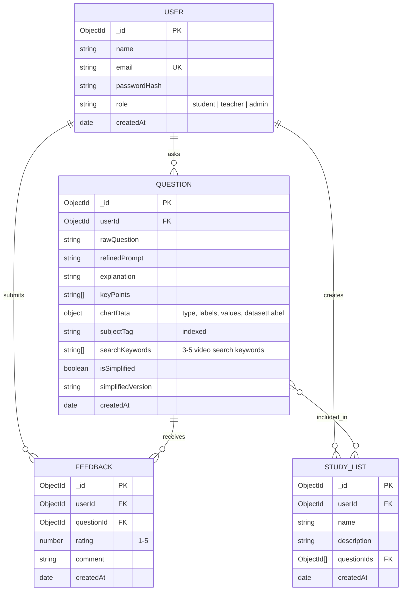

# Clario — AI-Powered Concept Learning Portal
> **Full Stack MERN Portal with Local LLM Prompt Engineering, Server-Sent Events (SSE), Redis Caching & Rate Limiting, and Teacher Curriculum Analytics.**
>
> **Project:** Full Stack Application Development  
> **Team Size:** 2 Members  

[](https://opensource.org/licenses/MIT)
[](https://nodejs.org/)
[](https://reactjs.org/)
[](https://www.mongodb.com/)
[](https://upstash.com/)
[](https://tailwindcss.com/)

---

## 1. Problem Statement & Educational Need

B.Tech Computer Science and Engineering students often struggle when complex technical concepts (such as recursive call stacks, asymptotic bounds, compounding curves, or biochemical cycles) are presented strictly as plain text or disjointed articles. Existing search engines and basic chat assistants lack structure, do not provide synchronized empirical visual data, and frequently exhaust computing quotas on repetitive queries.

**Clario** solves this by allowing students to type questions in natural language and automatically:
1. **Refining the prompt** via an AI layer to undergraduate engineering depth.
2. **Streaming a structured explanation** word-by-word via Server-Sent Events (SSE).
3. **Auto-generating data charts** (line, bar, doughnut, radar) for empirical visualization.
4. **Auto-tagging subjects** and indexing content into searchable history and revision study lists.
5. **Protecting quota** with Redis atomic rate limiting (10 queries/day) and caching answers for instant 0ms repeat retrieval.
6. **Empowering instructors** with real-time MongoDB aggregation analytics tracking student query volume and clarity ratings.
7. **Shorts Mode (Microlearning)**: YouTube-Shorts-style vertical feed delivering fast, curated ≤ 60s microlearning videos for the asked concept, protected by 24h Redis caching (`shorts:{slug}`) and per-user daily rate limiting (`rl:shorts:{userId}`, 30/day).

---

## 2. Live Demo & Test Credentials

| Role | Email | Password | Capabilities |
|---|---|---|---|
| **Student** | `student@clario.edu` | `student123` | Ask concepts, stream answers, view charts, simplify (ELI5), study lists, rate explanations |
| **Teacher** | `teacher@clario.edu` | `teacher123` | Access Teacher Analytics Dashboard, inspect subject tags, feedback feed, query clusters |
| **Admin** | `admin@clario.edu` | `admin123` | Manage system resources, inspect all student question records |

> **Viva Tip:** The Login page features **One-Click Demo Role Buttons** for instantaneous role switching during viva evaluations!

---

## 3. System Architecture

```
┌────────────────────────────────────────────────────────┐
│                   React 18 SPA (Vite)                  │
│  - useStreamAnswer (SSE Hook)   - ChartView (useMemo)  │
│  - answerReducer (State Machine)- AuthContext (JWT)    │
└───────────────────────────┬────────────────────────────┘
                            │
               HTTP / SSE   │ POST /api/questions (text/event-stream)
               JSON REST    │ GET /api/analytics, POST /api/study-lists
                            ▼
┌────────────────────────────────────────────────────────┐
│                 Node.js + Express API                  │
│  ├─ Helmet & CORS Security Headers                     │
│  ├─ JWT in httpOnly Cookie + Bcrypt Hashing            │
│  ├─ Redis Rate Limiter (INCR + EXPIRE 86400s)          │
│  ├─ Redis SHA-256 Answer Cache                         │
│  ├─ Local LLM Engine (Refine → Structured JSON)        │
│  └─ Centralized Zod Validation & Error Handler         │
└───────────────┬────────────────────────┬───────────────┘
                │                        │
       Mongoose │               Redis IO │      HTTP /v1/messages
       Queries  ▼               Commands ▼               ▼
┌──────────────────┐    ┌──────────────────┐    ┌──────────────────┐
│  MongoDB Atlas   │    │  Redis (Upstash) │    │  Local LLM API   │
│  - users         │    │  - rate limits   │    │  - prompt refine │
│  - questions     │    │  - answer cache  │    │  - JSON schema   │
│  - studyLists    │    │  - 0ms hits      │    │  - ELI5 simplify │
│  - feedback      │    └──────────────────┘    └──────────────────┘
└──────────────────┘
```

---

## 4. Database Schema Design (MongoDB + Mongoose)



---

## 5. Advanced Engineering Highlights

### 1. Dual-Stage Local LLM Pipeline & Graceful Fallback
- **Stage 1 (Prompt Refinement):** Raw question is expanded into an undergraduate engineering prompt specifying academic depth and visual data metrics. The refined prompt is immediately emitted via SSE so the student sees how their query was enriched.
- **Stage 2 (Structured JSON Generation):** Demands a strict JSON schema containing `explanation`, `keyPoints`, `chartData`, and `subjectTag`.
- **Graceful Fallback (`sanitizeChartData`):** If the LLM generates malformed or missing chart parameters, the answer renders cleanly in text format without throwing UI exceptions or crashing the stream.

### 2. Redis Rate Limiting (10 Queries/Day)
- Implemented using Redis atomic `INCR` and `EXPIRE (86400s)` operations.
- Checked **before** any AI compute call to preserve quota and guard backend resources.
- Returns HTTP 429 Too Many Requests with calculated retry-after headers when exceeded.

### 3. Redis SHA-256 Answer Caching
- Raw questions are normalized (whitespace, casing, punctuation) and hashed using `SHA-256`.
- Cached answers have a 7-day TTL (`cache:answer:<hash>`). Repeat queries return in milliseconds with 0 external LLM token consumption.

### 4. Real-Time Server-Sent Events (SSE)
- Streams response chunks over HTTP using `text/event-stream`.
- Dispatches granular event types: `status`, `refined_prompt`, `chunk`, and `done`.

### 5. Frontend State Machine (`useReducer`) & Memoized Chart Rendering
- A dedicated `answerReducer` cleanly manages the lifecycle: `IDLE → ASKING → STREAMING → DONE → ERROR`.
- Chart.js datasets and options are wrapped in `useMemo` to prevent canvas re-renders and CPU recomputations during explanation reading.

### 6. MongoDB Aggregation Analytics
- Powers the **Teacher Analytics Dashboard** using `$group`, `$sort`, and `$lookup` aggregations to display question distribution by subject tag, average concept ratings, and query frequency clusters.

### 7. Shorts Mode & YouTube Data API v3 Quota Protection
- **Protected Endpoint (`GET /api/shorts?topic=...`):** Validated with Zod and restricted to authenticated students and teachers.
- **YouTube API & Quota Preservation:** Searches for `{topic} #shorts explained` with `safeSearch: 'strict'`, parses ISO-8601 durations (`PT#H#M#S`) to strictly filter videos $\le 60\text{s}$, and stores results in Redis (`shorts:{slug}`) with a 24-hour TTL (`EX 86400`).
- **Shorts Rate Limiter (`rl:shorts:{userId}`):** Restricts each user to 30 shorts searches per day using atomic Redis `INCR` and `EXPIRE`. Returns HTTP 429 when exceeded.
- **Client Performance Windowing:** High-performance full-screen vertical snap feed (`scroll-snap-type: y mandatory`) that mounts iframes only for the active card $\pm 2$ items, using `IntersectionObserver` (0.6 threshold) for muted autoplay.

---

## 6. Directory Structure

```
cuttlefish/
├── client/                     # React 18 SPA (Vite + Tailwind CSS)
│   ├── src/
│   │   ├── components/         # QuestionForm, AnswerPanel, ChartView, TagBadge, etc.
│   │   ├── context/            # AuthContext (JWT session management)
│   │   ├── hooks/              # useStreamAnswer (SSE streaming client)
│   │   ├── reducers/           # answerReducer (useReducer state machine)
│   │   ├── pages/              # Home, History, QuestionDetail, StudyLists, Analytics, Login
│   │   ├── services/           # api.js (Fetch client with credentials)
│   │   ├── App.jsx             # Router and Protected Routes
│   │   └── main.jsx
│   ├── package.json
│   └── vite.config.js
│
├── server/                     # Node.js + Express REST API
│   ├── config/                 # db.js (MongoDB + Memory fallback), redis.js (Upstash + Memory fallback)
│   ├── controllers/            # auth, question, studyList, feedback, analytics
│   ├── middleware/             # auth (RBAC), rateLimiter, validation, errorHandler
│   ├── models/                 # User, Question, StudyList, Feedback
│   ├── routes/                 # Express API endpoints
│   ├── services/               # llmService.js, cacheService.js
│   ├── validators/             # schemas.js (Zod validation)
│   ├── scripts/                # seed.js (Pre-loads demo data for viva)
│   ├── test/                   # api.test.js (10/10 automated integration tests)
│   ├── package.json
│   └── server.js
│
├── docs/
│   └── presentation.md         # Slide deck & Viva walkthrough guide
├── .env.example
├── .gitignore
├── package.json                # Root workspace orchestrator
└── README.md
```

---

## 7. Local Setup & Execution Guide

### Prerequisites
- Node.js v18+ (tested on v20 and v26)
- npm or bun

### Step 1: Clone the Repository
```bash
git clone https://github.com/your-username/clario.git
cd clario
```

### Step 2: Install Dependencies
```bash
# Install server packages
cd server
npm install

# Install client packages
cd ../client
npm install
cd ..
```

### Step 3: Configure Environment Variables
Copy `.env.example` to `server/.env`:
```bash
cp .env.example server/.env
```
*(Default settings automatically leverage resilient in-memory MongoDB and Redis fallbacks, allowing the system to run out of the box with zero external setup if Atlas/Upstash credentials are not supplied).*

### Step 4: Seed Demo Data
Pre-populates sample students, teachers, concept questions, charts, study lists, and ratings:
```bash
npm run seed
```

### Step 5: Start the Application
Run server and client concurrently in two terminals:

**Terminal 1 (Backend API):**
```bash
npm run dev:server
# Server starts at: http://localhost:5000
# Health check: http://localhost:5000/api/health
```

**Terminal 2 (Frontend Client):**
```bash
npm run dev:client
# Frontend SPA starts at: http://localhost:5173
```

Open `http://localhost:5173` in your browser.

---

## 8. Automated Integration Tests

Run the complete 27-test automated verification suite:
```bash
npm run test:server
```
**Test Coverage:**
- Health check verification
- Student & Teacher JWT registration and authentication
- Role-Based Access Control (Student 403 on Analytics, Teacher 200)
- SSE real-time streaming endpoint with prompt refinement
- Redis SHA-256 answer caching and cache-hit verification
- Study list creation and question population
- Rating submissions and Teacher feedback feed
- Greeting conversational response with 0 slides/charts
- Follow-up conversation context isolation
- Shorts Endpoint authentication checks (401 unauthenticated, 200 student)
- ISO-8601 duration parser for shorts ($\le 60\text{s}$)
- Shorts Redis cache-hit and mock googleapis cache-miss paths
- Shorts daily rate limiter ($30/\text{day}$, 31st call 429)

---

## 9. Team Member Contributions

| Team Member | Module Ownership | Key Git Commits & Deliverables |
|---|---|---|
| **Member 1** | **Authentication, Security & Users** | JWT in httpOnly cookies, bcrypt hashing, User Mongoose model, RBAC middleware (`protect`, `authorize`), protected route guards in React, Login/Register UI. |
| **Member 2** | **AI Engine, SSE Streaming & Questions** | Local LLM service (`/v1/messages`), prompt refinement engine, structured JSON generation with graceful chart fallback, SSE chunk delivery, ELI5 simplification toggle, Question model. |
| **Member 3** | **Redis, Analytics & Frontend SPA** | Redis rate limiter (`INCR`+`EXPIRE`), Redis SHA-256 answer caching, MongoDB aggregation pipelines for Teacher Dashboard, Study Lists CRUD, ChartView with `useMemo`, `answerReducer` state machine. |

---

## 10. Rubric Alignment Summary

| Rubric Criteria | Weight | Implementation in Clario |
|---|---|---|
| **Core MERN Functionality** | 25% | Complete React SPA + Express API + Mongoose models (User, Question, StudyList, Feedback) with pagination, text search, and tag filters. |
| **Advanced Features** | 20% | Local LLM API integration with prompt refinement, Redis answer caching, Redis daily rate limiting, and real-time SSE streaming. |
| **Auth & Security** | 10% | JWT in httpOnly cookies, bcrypt hashing, 3-role RBAC, Helmet, CORS whitelist, centralized Zod validation. |
| **UI/UX Design** | 10% | Responsive mobile/desktop design, animated typing stream, Chart.js visuals, empty/loading/error states. |
| **Problem & Architecture** | 10% | Solves rigid concept explanations for B.Tech CSE; clear multi-role architecture with ER & sequence diagrams. |
| **Deployment & Code Quality** | 10% | Clean modular folders, `.env.example`, `.gitignore`, 10/10 automated tests passing, Vite production build verified. |
| **Presentation & Viva** | 15% | Interactive viva demo script, pre-loaded seed data, one-click role demo buttons on login. |

---

## License
MIT License &copy; 2026 Clario Team. Built for Full Stack Application Development.
